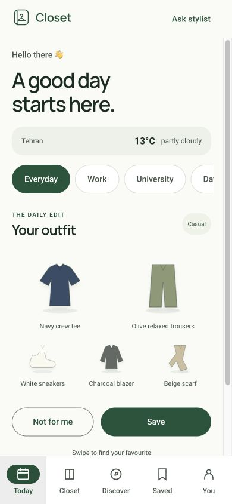
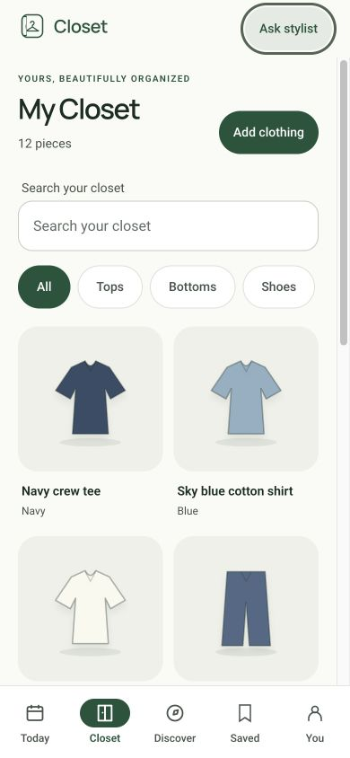
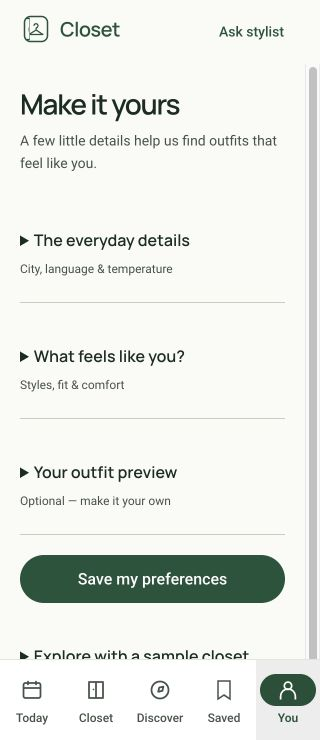

# Closet identity and interaction update

The Closet identity is an open wardrobe around a hanger. Forest green (#20543b), warm canvas (#fafbf7), Manrope headings and existing body typography remain the shared foundation. The logo is decorative next to the visible Closet name. Favicon, install icons and Apple touch icon are generated from the original vector in `apps/web/public/favicon.svg` using `pnpm --filter @closet/web pwa:assets`.

## Motion

The startup door opens once over 900ms, followed by a short hanger settle. Outfits settle down from the rail over 420ms with short stagger offsets. Fine-pointer hover gently tilts garments; keyboard focus lifts them without hiding the focus ring. No infinite decorative motion. CSS and the existing MotionConfig honor reduced motion. The splash ends as soon as the app is ready; it does not introduce a minimum loading time.

The in-app splash displays the web package version, currently **0.0.0**, rather than an invented release number. The OS-controlled PWA launch screen uses manifest icons/background; the version appears on the subsequent app-controlled splash. See [PWA manifest guidance](https://web.dev/learn/pwa/web-app-manifest).

## Layout and accessibility

Today, collections, settings and the demo auth form use a continuous canvas rather than nested bordered panels. Header spacing is shared. The reusable FAB sits 20px above the 80px navigation plus the device safe area; Closet itself continues to use the inline Add action, so there is no floating overlap.

Search has a persistent visible label and fallback placeholder. All TextFields get unique IDs and combine caller descriptions with their error/help text. These changes follow [WAI form label guidance](https://www.w3.org/WAI/tutorials/forms/labels/). Decorative swipe badges and unnamed illustrations are hidden from assistive technology; repeated illustration gradients have unique IDs. Shared focus indicators remain visible.

Additional accessibility lint errors cover ARIA attributes/types, required role properties, associated labels, keyboard equivalents, tab order and autofocus. Regression tests cover search label/placeholder and repeated field/error associations.

## Browser verification

- Observed startup status and version in the accessibility tree.
- Reviewed Closet and unboxed Today at 390px; checked Settings at 320px.
- At 320px, document width equals viewport width (no page horizontal overflow).
- Opened stylist dialog, observed dialog focus, pressed Escape, confirmed focus returned to Ask stylist.
- Existing reduced-motion branches retained; new CSS animations explicitly disabled under reduced motion.

Automated checks and browser inspection do not certify full WCAG conformance. Real VoiceOver/TalkBack, large OS text settings, touch physics and installed-device splash behaviour still require hardware testing. This pass uses mock authentication, not live Clerk.

